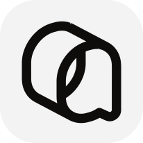

<p align="center">
  
</p>

<h1 align="center">OMC Qoder OAuth</h1>

<p align="center">
  <a href="https://github.com/WizisCool/oh-my-cpa">
    <picture>
      <source media="(prefers-color-scheme: dark)" srcset="https://raw.githubusercontent.com/WizisCool/oh-my-cpa/main/web/src/assets/brand/omc-wordmark-dark.svg">
      
    </picture>
  </a>
</p>

<p align="center">
  Native Qoder and Qoder CN OAuth login for
  <a href="https://github.com/router-for-me/CLIProxyAPI">CLIProxyAPI</a>
</p>

<p align="center">
  <a href="https://github.com/WizisCool/omc-qoder-oauth/releases"></a>
  <a href="https://github.com/WizisCool/omc-qoder-oauth/actions/workflows/build.yml"></a>
  
  
</p>

<p align="center">
  <a href="README.md">English</a> · <a href="README.zh-CN.md">简体中文</a>
</p>

OMC Qoder OAuth adds the `qoder` provider to CLIProxyAPI. Sign in with a Qoder or
Qoder CN account from your panel's OAuth flow, and CPA gains model discovery from
Qoder's own catalogue, OpenAI-compatible execution and normalized quota, with no
separate process and no local Qoder desktop client.

The plugin is developed and maintained as part of the
[Oh-My-CPA](https://github.com/WizisCool/oh-my-cpa) ecosystem, the self-hosted
control plane and usage console for CLIProxyAPI.

## Two portals, one provider

Qoder accounts can sign in through two portals. Both produce the same credential
(`"type": "qoder"`) and share one executor, but they are separate accounts on
separate hosts, so the plugin registers two OAuth login entries instead of one
entry plus a site dropdown.

| Portal | Login entry | Sign-in page | OpenAPI host |
| --- | --- | --- | --- |
| Qoder | `qoder` | `https://qoder.com/device/selectAccounts` | `openapi.qoder.sh` |
| Qoder CN | `qoder-cn` | `https://qoder.cn/device/selectAccounts` | `openapi.qoder.com.cn` |

On a panel that renders per-entry metadata (CPA v8.0.51+) each entry appears as
its own card with its own name and logo. Loading the plugin needs **CPA v8.0.49+**,
which is where schema 10 first ships; the separate names and artwork need
v8.0.51+. On an older host both identifiers still work, and the panel shows the
plugin's own name and logo for them.

- Pick the portal by picking its entry. The entry wins over any `site` hint.
- Each credential records the portal that signed it in, as `site` and as the
  credential's `oauth_provider`.
- `site` (default `qoder`) is only the fallback for a login request that names no
  entry, such as a host that starts a login under the plugin identifier alone.
- An explicit but invalid `site` value is rejected rather than silently resolved.

## Panel-agnostic by design

Everything user-facing is rendered by the host: the OAuth tiles, config fields,
static assets and quota views all go through CPA's plugin ABI and management API.
The plugin is first-class in [Oh-My-CPA](https://github.com/WizisCool/oh-my-cpa)
and works the same in CPA's own Management Center or any other panel that speaks
CPA's management API.

OAuth starts and polling use CPA's authenticated management API. Public plugin
resources contain only static logos and the optional description declaration:
the two SVGs and `omc.json`. A request to those routes cannot start a flow, and a
query parameter never triggers an action.

Sign-in is the PKCE device flow Qoder's own desktop client uses. The plugin builds
the entry's `device/selectAccounts` URL, polls the portal's OpenAPI host for the
device token, and trades that token for the job token model calls use. No local
callback listener and no manual callback URL submission is required.

## Features

- Qoder and Qoder CN OAuth through the PKCE device flow, one login entry per portal.
- Job token exchange with single-use refresh tokens; Qoder CN accounts that refuse
  the exchange keep their device token as the chat token.
- Model discovery from Qoder's `/algo/api/v2/model/list` catalogue, lowercased for
  CPA routing, with a shipped fallback list when the catalogue cannot be read.
- OpenAI chat completions in and out, streaming and non-streaming, including tool
  calls, reasoning content and image inputs.
- Normalized quota from Qoder's `/sash/api/v2/me/usage` usage envelope.
- Per-credential concurrency control.
- Import of existing `"type": "qoder"` auth files.
- Error mapping that keeps a queue notice, a usage limit and a lapsed sign-in on
  their own status codes instead of folding them into a generic upstream failure.

## Installation

Add this repository as a plugin-store source:

```yaml
plugins:
  enabled: true
  dir: /path/to/plugins
  store-sources:
    - https://raw.githubusercontent.com/WizisCool/omc-qoder-oauth/refs/heads/main/registry.json
  configs:
    omc-qoder-oauth:
      enabled: true
```

Then install `omc-qoder-oauth` from the plugin store and open its OAuth tile in
your panel. The store and shared-library name is `omc-qoder-oauth`; the CPA
credential provider identifier remains `qoder`. See
[docs/USAGE.md](docs/USAGE.md) for login, configuration, quota and
troubleshooting.

Releases are created by GitHub Actions whenever a `v*` tag is pushed.

## Configuration

| Field | Type | Default | Values |
| --- | --- | --- | --- |
| `site` | enum | `qoder` | Fallback portal when a login request names no entry: `qoder`, `qoder-cn` |
| `max_concurrency` | integer | `3` | 1–100 requests per credential |
| `cosy_version` | string | `1.1.69` | Qoder client version the COSY envelope claims |
| `max_tokens` | integer | `32000` | Output budget used when the client names none, 1–1000000 |

## Development

The plugin implementation lives in [`go/`](go/). Tests run without network access
after modules are downloaded:

```sh
cd go
go mod download
GOPROXY=off GOSUMDB=off go test ./...
GOPROXY=off GOSUMDB=off go vet ./...
```

A local native build for the current machine:

```sh
cd go
CGO_ENABLED=1 go build -buildmode=c-shared -o ../build/omc-qoder-oauth.so .
```

Use `.dylib` on macOS and `.dll` on Windows. `build/` is ignored by git.

The release workflow builds these artifacts from a tag:

```text
omc-qoder-oauth_<version>_linux_amd64.zip
omc-qoder-oauth_<version>_linux_arm64.zip
omc-qoder-oauth_<version>_darwin_amd64.zip
omc-qoder-oauth_<version>_darwin_arm64.zip
omc-qoder-oauth_<version>_windows_amd64.zip
omc-qoder-oauth_<version>_windows_arm64.zip
checksums.txt
omc-qoder-oauth.omc.json
```

Each archive contains the correctly named `omc-qoder-oauth.so`,
`omc-qoder-oauth.dylib` or `omc-qoder-oauth.dll` at its root. `checksums.txt`
covers every archive, and the plugin store verifies the archive it downloads
against it. `omc-qoder-oauth.omc.json` is the optional description declaration
described in [docs/USAGE.md](docs/USAGE.md); the bytes it publishes are the same
bytes the plugin embeds and serves.

See [CONTRIBUTING.md](CONTRIBUTING.md) for commit conventions, test expectations,
and ecosystem development standards.

## Project layout

```text
assets/qoder-color.svg  Official light-tile mark: plugin logo and Qoder entry
assets/qoder.svg        Inverted mark used for the Qoder CN entry
go/                     Go/cgo plugin implementation and tests
go/assets/              Embedded artwork and the omc.json declaration
docs/USAGE.md           Operator installation and usage guide
registry.json           CLIProxyAPI plugin-store metadata
```

The Go implementation is independent. Protocol provenance, including the COSY
envelope and the device flow, is recorded in [NOTICE.md](NOTICE.md).

## License

[MIT](LICENSE)
